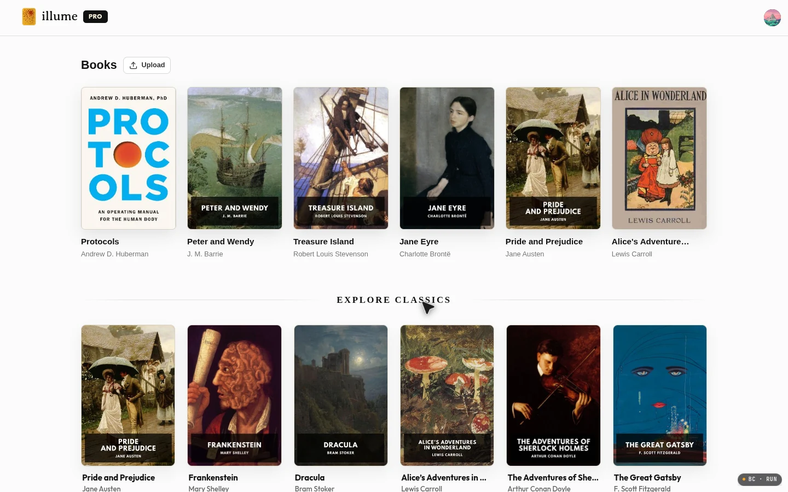
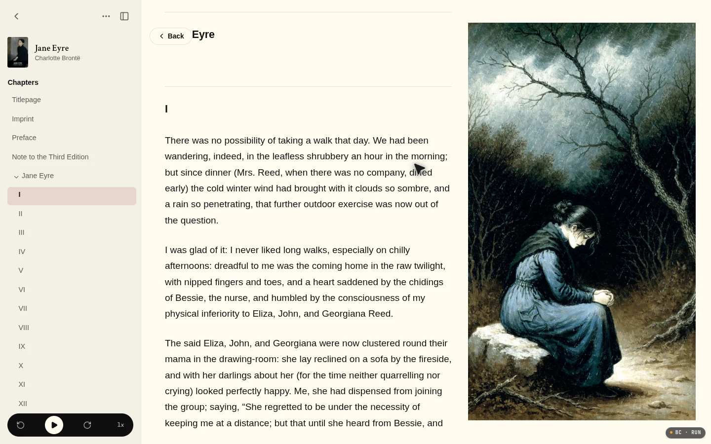

# Illume Reader

**A reading app that makes books feel lit from within.**

Illume is a full-stack EPUB and PDF reader with a private, per-user library, synced reading progress, natural narration that highlights each word as it is spoken, and an optional Image Mode that illustrates what you are reading. It runs as a web app (React + Supabase) with a companion iOS app in [`illume-ios/`](illume-ios/).

Live at **[illumereader.com](https://illumereader.com)**

<p align="center">
  
  
</p>

## What it does

**Your own library.** Upload EPUBs and PDFs, or pick from a shelf of public-domain classics. Every book belongs to one account, with row-level security in Postgres and private storage buckets, so nobody else can list, read, or download your files.

**Read, or listen.** Narration runs through a Supabase Edge Function that keeps the speech provider's key server-side. The reader tracks the spoken word and highlights it in the text, follows along across chapters, and lets you jump by clicking a word.

**Image Mode.** Ask for a scene and Illume writes a standalone illustration prompt for the current passage, renders it, and caches it against that section so re-reads reuse the image instead of paying to generate it again. Generated images live in a private bucket.

**Progress that follows you.** Position, percentage read, and time left sync per book, so the web reader and the iOS app pick up where you stopped.

**Pro.** A Stripe-backed subscription raises the storage quota and the monthly image allowance, and unlocks the billing portal for self-service changes.

**Owner dashboard.** A separate `/dashboard` route aggregates users, books, generated images, storage use, and content integrations. It is gated behind an allowlisted Google account and reads through an Edge Function rather than exposing privileged database access to the browser.

## Stack

| Layer | Choice |
| --- | --- |
| Web client | React 19, Vite, TypeScript |
| Reading engine | Custom EPUB parser, `pdfjs-dist` for PDFs |
| Backend | Supabase: Auth, Postgres with RLS, Storage, Edge Functions |
| Payments | Stripe Checkout, Billing Portal, webhooks |
| Narration | Edge Function wrapping the speech provider |
| Images | Edge Function calling the image model, private bucket + usage ledger |
| iOS | Expo / React Native in [`illume-ios/`](illume-ios/) |

## Run it locally

```bash
npm install
npm run dev
```

Vite serves the app on `http://localhost:5173`.

Copy `.env.example` to `.env.local` and fill in your own Supabase project:

```bash
VITE_SUPABASE_URL=https://<project-ref>.supabase.co
VITE_SUPABASE_PUBLISHABLE_KEY=<publishable-key>
VITE_FREE_USER_STORAGE_QUOTA_BYTES=104857600    # 100 MB
VITE_PRO_USER_STORAGE_QUOTA_BYTES=5368709120    # 5 GB
```

Other scripts:

```bash
npm run build       # typecheck and production build
npm run typecheck   # TypeScript only
npm run preview     # serve the production build
```

## Database and storage

Apply the migrations in [`supabase/migrations`](supabase/migrations) with the Supabase CLI. They create:

- `public.books` — one row per book, scoped to its owner
- `public.billing_profiles` — plan and subscription state
- `public.reader_images` and `public.reader_image_usage` — generated images and quota tracking
- a private `epubs` bucket for EPUB/PDF uploads and a private `reader-images` bucket
- RLS policies so a user can only reach their own rows and files

## Edge Functions

All privileged work happens in [`supabase/functions`](supabase/functions). Set secrets with `supabase secrets set` — never in the client:

```bash
supabase secrets set OPENROUTER_API_KEY=...
supabase secrets set SPEECHIFY_API_KEY=...
supabase secrets set STRIPE_SECRET_KEY=...
supabase secrets set STRIPE_PRO_PRICE_ID=...
supabase secrets set STRIPE_WEBHOOK_SECRET=...
supabase secrets set SITE_URL=https://your-domain
```

Then deploy:

```bash
supabase functions deploy generate-reader-image
supabase functions deploy edge-tts
supabase functions deploy delete-reader-book
supabase functions deploy reader-dashboard
supabase functions deploy create-checkout-session
supabase functions deploy create-billing-portal
supabase functions deploy delete-account
supabase functions deploy stripe-webhook --no-verify-jwt
```

The content integrations (YouTube, Instagram, TikTok feeds and posting) are optional and each needs its own OAuth app credentials; skip those functions if you do not want the dashboard's publishing tools.

## Stripe

Create a recurring Pro price, point `STRIPE_PRO_PRICE_ID` at it, and add a webhook endpoint at:

```
https://<project-ref>.supabase.co/functions/v1/stripe-webhook
```

Subscribe it to `checkout.session.completed`, `customer.subscription.created`, `customer.subscription.updated`, and `customer.subscription.deleted`. The webhook is the only thing that grants Pro, so keep the signing secret set.

## iOS app

`illume-ios/` is an Expo app that shares the same Supabase project and API surface:

```bash
cd illume-ios
npm install
npm run ios
```

It uses native Apple sign-in and a `illumereader.com/auth/native-callback` redirect, so add that URL to your Supabase Auth redirect allowlist if you point it at your own deployment.

## Project layout

```
src/            web client: reader, library, dashboard, EPUB/PDF parsers
supabase/       migrations, Edge Functions, local config
illume-ios/     Expo iOS client
public/         landing art, classic covers, static assets
docs/           self-hosting notes and screenshots
```

## Notes

- The reader is designed around a single-user-per-library model. Sharing a book means exporting the file, not sharing a link.
- Image Mode is optional; without the image function the reader works exactly as before.
- Before going live with real users, configure SMTP or email templates in Supabase Auth and add Terms and Privacy pages.
